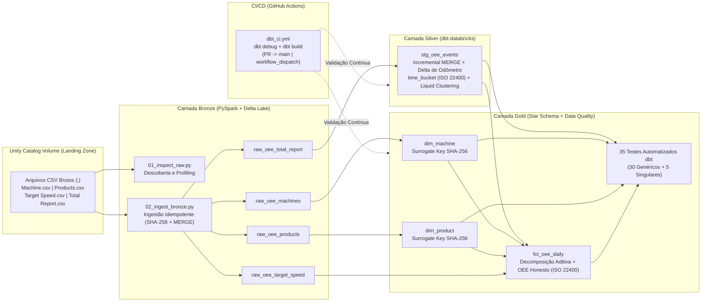

# Industrial OEE Lakehouse

Pipeline analítico end-to-end de **Overall Equipment Effectiveness (OEE)** para manufatura industrial, construído sobre **Databricks Free Edition**, **Unity Catalog**, **Delta Lake**, **PySpark**, **dbt-databricks** e **GitHub Actions**.

O projeto demonstra uma arquitetura **Medallion** completa em produção — da inspeção e ingestão idempotente de arquivos brutos em Unity Catalog Volumes até a modelagem dimensional (Star Schema) aderente à norma **ISO 22400**, tratamento de anomalias reais de telemetria PLC, **35 testes automatizados de qualidade de dados** e CI/CD contínuo.

---

## Visão Geral da Arquitetura



---

## Stack Tecnológica

| Camada / Responsabilidade | Tecnologia |
| --- | --- |
| **Plataforma & Governança** | Databricks Free Edition + Unity Catalog (`industrial_lakehouse.{bronze,silver,gold}`) |
| **Armazenamento** | Delta Lake com **Liquid Clustering** |
| **Ingestão (Raw → Bronze)** | PySpark + `DeltaTable` (`MERGE INTO`) |
| **Transformação (Bronze → Silver → Gold)** | `dbt-databricks` (`dbt-core 1.10`) |
| **Qualidade de Dados** | 35 dbt Data Tests (30 genéricos + 5 singulares de reconciliação/invariantes) e Source Freshness |
| **CI/CD** | GitHub Actions com GitHub Secrets |

---

## Estrutura do Repositório

```text
industrial-oee-lakehouse/
├── .github/
│   └── workflows/
│       └── dbt_ci.yml                              # Pipeline CI/CD (dbt debug + dbt build)
├── databricks/
│   └── notebooks/
│       ├── 01_inspect_raw.py                       # Inspeção dos CSVs no Unity Catalog Volume
│       └── 02_ingest_bronze.py                     # Ingestão 1:1 idempotente (SHA-256 + MERGE)
├── dbt_project/
│   ├── dbt_project.yml                             # Configuração do projeto dbt (Silver/Gold Delta)
│   ├── profiles.yml                                # Profile Databricks via env_var()
│   ├── macros/
│   │   └── generate_schema_name.sql                # Controle explícito de schemas (silver/gold)
│   ├── models/
│   │   ├── bronze/
│   │   │   └── sources.yml                         # Fontes Bronze + Source Freshness (ingested_at)
│   │   ├── silver/
│   │   │   ├── stg_oee_events.sql                  # Incremental MERGE, delta de odômetro e time_bucket
│   │   │   └── schema.yml                          # 9 testes genéricos da camada Silver
│   │   └── gold/
│   │       ├── dim_machine.sql                     # Dimensão de máquinas (10 máquinas)
│   │       ├── dim_product.sql                     # Dimensão de produtos (18 produtos)
│   │       ├── fct_oee_daily.sql                   # Fato diária OEE (grão data + máquina + produto)
│   │       └── schema.yml                          # 21 testes genéricos da camada Gold
│   └── tests/
│       ├── assert_valid_oee_bounds.sql             # Pilares e oee_score em [0, 1] quando não nulos
│       ├── assert_non_negative_delta_biscuits.sql  # delta_total_biscuits_made >= 0 (Silver e Gold)
│       ├── assert_gold_time_conservation.sql       # Conservação aditiva dos 5 buckets de tempo (< 0,01 min)
│       ├── assert_quality_null_without_telemetry.sql # quality_rate NULL sem telemetria de contador total
│       └── assert_silver_gold_reconciliation.sql   # Gate de reconciliação de eventos e duração (Silver = Gold)
├── .env.example                                    # Template de variáveis de ambiente (sem segredos)
└── .gitignore                                      # Proteção de .env, target/, logs/ e .user.yml
```

---

## Auditoria de Qualidade & Decisões de Engenharia (Data Quality)

Uma auditoria forense sobre os 8.043 eventos da camada Bronze revelou **4 características reais do dataset industrial bruto** que, se ignoradas, distorcem severamente o cálculo de OEE. A arquitetura foi projetada para tratar cada achado com rigor semântico (ISO 22400), sem perda de registros (**100% de reconciliação: 8.043 eventos e 179.775,96 minutos nas três camadas**):

1. **Comportamento de odômetro (contador acumulado) em `Biscuit Filling Machine` e `Biscuit Sprinkling Machine`**
   - **Achado:** os valores cronológicos de `totalbiscuitsmade` na origem crescem de forma acumulada entre eventos consecutivos (ex.: `136.864 → 139.083 → 153.553 → 180.473` em intervalos de `0,15` a `17 min`). Somar diretamente a leitura bruta inflava o volume total para `1,31 bilhão` de biscoitos.
   - **Decisão de engenharia (`stg_oee_events.sql`):** mantemos `raw_total_biscuits_made` preservado para auditoria e calculamos `delta_total_biscuits_made` via janela cronológica particionada por `machine_name` (`ORDER BY start_timestamp, end_timestamp, row_hash`), ignorando leituras zeradas intermediárias (`LAST_VALUE(..., TRUE)`) e detectando resets de PLC (`is_counter_reset = TRUE` quando a leitura cai em relação à anterior — **1.486 resets** detectados: `1.019` na Filling e `467` na Sprinkling). Em execuções incrementais, a última leitura válida (`> 0`) já materializada por máquina na Silver é incorporada como âncora da janela, preservando idempotência no primeiro evento de novos lotes.
   - **Observação adicional:** na `Biscuit Filling Machine`, o campo bruto `goodmadebiscuits` (`457,28M`) também apresenta comportamento acumulado na origem; ao confrontá-lo com `delta_total_biscuits_made` (`299,58M`), `quality_rate` é limitado ao teto `1,00` (`LEAST(1.0, ...)`), mantendo rastreabilidade total nas colunas aditivas.

2. **Ausência de telemetria de contador total/refugo em 8 das 10 máquinas**
   - **Achado:** em **8 máquinas** (`Boxing`, `Forming`, `Heating`, `Mixing`, `Pressing`, `Jam`, `Packaging Heat` e `Topping`), o campo `totalbiscuitsmade` é `0` em **100% dos eventos** (`1.937` de `1.937` linhas), impossibilitando o cálculo confiável de refugo/qualidade ou performance.
   - **Decisão de engenharia:** removemos qualquer imputação artificial (como `GREATEST(raw_total, good)`), marcamos `has_total_counter_telemetry = (raw_total_biscuits_made > 0)` na Silver e retornamos **`NULL`** para `delta_total_biscuits_made`, `performance_rate`, `quality_rate` e `oee_score` sempre que não houver telemetria válida — nunca forçando `100%` ou `0%` artificiais. O teste singular `assert_quality_null_without_telemetry.sql` bloqueia regressões em CI.

3. **Exclusão de `NO (No Order)` do *Planned Production Time* (ISO 22400)**
   - **Achado:** `NO (No Order)` representa **`137.694,36 min` (76,6%)** de todo o tempo registrado (`179.775,96 min`). Incluí-lo no denominador de Disponibilidade penalizava o OEE por falta de demanda comercial, e não por indisponibilidade do equipamento.
   - **Decisão de engenharia (`fct_oee_daily.sql`):** o tempo é decomposto de forma estritamente aditiva em 5 buckets mutuamente exclusivos (`no_order_minutes`, `maintenance_minutes`, `changeover_minutes`, `explicit_run_time_minutes`, `unclassified_minutes`), com `planned_production_minutes = total_duration_minutes - no_order_minutes` (`42.081,59 min`) e validação contínua pelo teste `assert_gold_time_conservation.sql`.

4. **Natureza de *event/downtime log* do dataset (apenas 9 eventos explícitos de `Run Time`)**
   - **Achado:** o arquivo `Total Report.csv` registra majoritariamente eventos de parada/transição (`CC (Changeover Cleaning)`: `4.021` eventos / `33.679,23 min`; `NO (No Order)`: `3.995` eventos / `137.694,36 min`; `0` não classificado: `12` eventos / `7.950,64 min`; `PM (Maintenance)`: `6` eventos / `211,85 min`) e apenas **9 eventos** explícitos de `Run Time` (`239,87 min`, todos concentrados na `Biscuit Filling Machine`).
   - **Decisão de engenharia:** `CC (Changeover)` e `NO (No Order)` **não** são tratados como tempo produtivo. A disponibilidade usa exclusivamente `explicit_run_time_minutes / planned_production_minutes`, e `expected_biscuits = (explicit_run_time_minutes / 60.0) * target_biscuits_per_hour` é materializado como coluna aditiva na Gold para permitir cálculo ponderado honesto em qualquer ferramenta de BI (`NULL` onde `expected_biscuits = 0`).

### Outras Decisões Técnicas Consolidadas
- **Ingestão Bronze 1:1 Idempotente (`02_ingest_bronze.py`):** leitura com `.option("sep", ";")` e `inferSchema=false`, `row_hash` (`SHA-256`) eliminando 1 registro duplicado exato em `Total Report.csv` (8.043 eventos únicos persistidos) e carga idempotente via `DeltaTable.merge()`.
- **Higienização de Chaves e Tipos (`stg_oee_events.sql` e dimensões):** `TRIM()` em `machine` e `product` (eliminando espaços à direita e garantindo `0` registros órfãos nos joins), parsing resiliente de timestamps (`d/M/yy HH:mm` / `M/d/yy HH:mm`), conversão de decimais com vírgula (`REPLACE(..., ',', '.')`) e correção do typo `bsicuits_per_pallet` → `biscuits_per_pallet` em `dim_product` (preservando `cases_per_pallet`).
- **Delta Lake Liquid Clustering:** `clusterBy("ingestion_date")` na Bronze, `liquid_clustered_by=['event_date', 'machine_name']` na Silver e `liquid_clustered_by=['event_date', 'machine_sk']` na Gold.
- **35 Testes Automatizados de Qualidade (`dbt build`):** 30 testes genéricos (`not_null`, `unique`, `accepted_values`, `relationships`) + 5 testes singulares (bounds `[0, 1]`, delta não negativo, conservação de tempo, honestidade de `quality_rate` e reconciliação Silver → Gold).

---

## Resultados Validados (Camada Gold)

### Reconciliação Global (`industrial_lakehouse.gold.fct_oee_daily`)

| Métrica Global | Valor |
| --- | ---: |
| Linhas na Gold (`fct_oee_daily`) | 193 |
| Total de eventos (`SUM(event_count)`) | **8.043** *(100% da Bronze/Silver)* |
| `total_duration_minutes` | **179.775,96 min** |
| `planned_production_minutes` | 42.081,59 min |
| `no_order_minutes` | 137.694,36 min |
| `changeover_minutes` | 33.679,23 min |
| `maintenance_minutes` | 211,85 min |
| `explicit_run_time_minutes` | 239,87 min |
| `unclassified_minutes` | 7.950,64 min |
| `SUM(delta_total_biscuits_made)` | 368.023.865 |
| `SUM(good_biscuits_made)` | 458.308.621 |
| `SUM(counter_reset_count)` | 1.486 |

### Decomposição de Tempos e KPIs Ponderados por Máquina

Resultado obtido via `dbt show` sobre `industrial_lakehouse.gold.fct_oee_daily` × `industrial_lakehouse.gold.dim_machine` (`NULL` exibido onde não há telemetria confiável):

| machine_name | planned_min | no_order_min | changeover_min | maint_min | run_time_min | unclass_min | delta_total_biscuits | good_biscuits | resets | avail_% | perf_% | qual_% | oee_% |
| --- | ---: | ---: | ---: | ---: | ---: | ---: | ---: | ---: | ---: | ---: | ---: | ---: | ---: |
| Biscuit Filling Machine | 19.360,64 | 22.848,37 | 10.958,47 | 211,68 | 239,87 | 7.950,63 | 299.575.794 | 457.277.725 | 1.019 | 1,24 | 100,00 | 100,00 | 1,24 |
| Biscuit Boxing Machine | 5.230,35 | 41.509,58 | 5.230,27 | 0,08 | 0,00 | 0,00 | NULL | 57.152 | 0 | 0,00 | NULL | NULL | NULL |
| Biscuit Forming Machine | 4.027,76 | 16.289,09 | 4.027,68 | 0,08 | 0,00 | 0,00 | NULL | 14.121 | 0 | 0,00 | NULL | NULL | NULL |
| Biscuit Heating Machine | 3.821,04 | 7.032,35 | 3.821,04 | 0,00 | 0,00 | 0,00 | NULL | 1.995 | 0 | 0,00 | NULL | NULL | NULL |
| Biscuit Sprinkling Machine | 3.624,60 | 2.948,61 | 3.624,59 | 0,00 | 0,00 | 0,02 | 68.448.071 | 537.444 | 467 | 0,00 | NULL | 0,79 | NULL |
| Biscuit Mixing Machine | 3.142,07 | 29.525,17 | 3.142,07 | 0,00 | 0,00 | 0,00 | NULL | 52.358 | 0 | 0,00 | NULL | NULL | NULL |
| Biscuit Pressing Machine | 2.366,76 | 4.295,16 | 2.366,76 | 0,00 | 0,00 | 0,00 | NULL | 292.149 | 0 | 0,00 | NULL | NULL | NULL |
| Biscuit Jam Machine | 290,97 | 4.338,80 | 290,97 | 0,00 | 0,00 | 0,00 | NULL | 23.748 | 0 | 0,00 | NULL | NULL | NULL |
| Packaging Heat Machine | 207,17 | 7.427,98 | 207,17 | 0,00 | 0,00 | 0,00 | NULL | 48.067 | 0 | 0,00 | NULL | NULL | NULL |
| Biscuit Topping Machine | 10,23 | 1.479,26 | 10,23 | 0,00 | 0,00 | 0,00 | NULL | 3.862 | 0 | 0,00 | NULL | NULL | NULL |

---

## Como Executar Localmente

### Pré-requisitos
- Python 3.9+ (recomendado 3.11)
- Workspace Databricks com Unity Catalog habilitado, SQL Warehouse ativo e catálogo `industrial_lakehouse` (`bronze`, `silver`, `gold`)
- Arquivos CSV carregados no Volume `/Volumes/industrial_lakehouse/bronze/landing_zone/oee/`

### 1. Ingestão no Databricks (Raw → Bronze)
Execute os notebooks no Databricks Workspace (conectados ao catálogo `industrial_lakehouse`):
1. `databricks/notebooks/01_inspect_raw.py` — valida os arquivos `.csv`, tamanho, schema bruto e amostra.
2. `databricks/notebooks/02_ingest_bronze.py` — cria/atualiza de forma idempotente as 4 tabelas Delta na camada Bronze.

### 2. Configuração do Ambiente Local
Clone o repositório e instale o `dbt-databricks`:

```powershell
git clone https://github.com/Raniere-Pereira/industrial-oee-lakehouse.git
cd industrial-oee-lakehouse
pip install dbt-databricks
```

Copie o arquivo `.env.example` para `.env` na raiz do repositório e preencha suas credenciais do Databricks SQL Warehouse (`.env` está listado no `.gitignore` e nunca deve ser versionado):

```dotenv
DATABRICKS_HOST=seu-workspace.cloud.databricks.com
DATABRICKS_HTTP_PATH=/sql/1.0/warehouses/seu-warehouse-id
DATABRICKS_TOKEN=dapi...
```

### 3. Execução do dbt (PowerShell)
Carregue as variáveis do `.env` na sessão atual e rode `dbt debug` e `dbt build`:

```powershell
Get-Content .env | ForEach-Object {
    if ($_ -match '^\s*([^#][^=]+?)\s*=\s*(.*)\s*$') {
        [Environment]::SetEnvironmentVariable($matches[1], $matches[2], 'Process')
    }
}

cd dbt_project
dbt debug --profiles-dir .
dbt build --profiles-dir .
```

Para executar backfill completo da Silver e Gold:

```powershell
dbt build --profiles-dir . --select stg_oee_events+ --full-refresh
```

Para consultar a decomposição de tempos e os KPIs ponderados via CLI:

```powershell
dbt show --profiles-dir . --limit 20 --inline "
WITH base AS (
    SELECT
        m.machine_name,
        SUM(f.planned_production_minutes) AS planned_min,
        SUM(f.no_order_minutes) AS no_order_min,
        SUM(f.changeover_minutes) AS changeover_min,
        SUM(f.maintenance_minutes) AS maint_min,
        SUM(f.explicit_run_time_minutes) AS run_min,
        SUM(f.unclassified_minutes) AS unclass_min,
        SUM(f.delta_total_biscuits_made) AS delta_tot,
        SUM(f.good_biscuits_made) AS good_tot,
        SUM(f.expected_biscuits) AS exp_tot
    FROM industrial_lakehouse.gold.fct_oee_daily f
    JOIN industrial_lakehouse.gold.dim_machine m
      ON f.machine_sk = m.machine_sk
    GROUP BY 1
),
metrics AS (
    SELECT
        *,
        CASE WHEN planned_min > 0 THEN run_min / planned_min ELSE NULL END AS avail,
        CASE WHEN exp_tot > 0 AND delta_tot IS NOT NULL THEN LEAST(1.0, CAST(delta_tot AS DOUBLE) / exp_tot) ELSE NULL END AS perf,
        CASE WHEN delta_tot IS NOT NULL AND delta_tot > 0 THEN LEAST(1.0, CAST(good_tot AS DOUBLE) / CAST(delta_tot AS DOUBLE)) ELSE NULL END AS qual
    FROM base
)
SELECT
    machine_name,
    ROUND(planned_min, 2) AS planned_production_minutes,
    ROUND(no_order_min, 2) AS no_order_minutes,
    ROUND(changeover_min, 2) AS changeover_minutes,
    ROUND(maint_min, 2) AS maintenance_minutes,
    ROUND(run_min, 2) AS explicit_run_time_minutes,
    ROUND(unclass_min, 2) AS unclassified_minutes,
    delta_tot AS sum_delta_total_biscuits,
    good_tot AS sum_good_biscuits,
    ROUND(avail * 100, 2) AS weighted_avail_pct,
    ROUND(perf * 100, 2) AS weighted_perf_pct,
    ROUND(qual * 100, 2) AS weighted_qual_pct,
    CASE
        WHEN avail IS NOT NULL AND perf IS NOT NULL AND qual IS NOT NULL
        THEN ROUND((avail * perf * qual) * 100, 2)
        ELSE NULL
    END AS weighted_oee_pct
FROM metrics
ORDER BY weighted_oee_pct DESC NULLS LAST, planned_production_minutes DESC
"
```

---

## Execução via CI/CD (GitHub Actions)

O workflow [.github/workflows/dbt_ci.yml](.github/workflows/dbt_ci.yml) automatiza a validação completa (`dbt debug` + `dbt build`) em:
- **Pull Requests** direcionados à branch `main`;
- **Disparo manual** (`workflow_dispatch`) pela aba **Actions** no GitHub ou via GitHub CLI.

### Configuração dos Secrets no GitHub
Em **Settings → Secrets and variables → Actions → New repository secret**, configure:
- `DATABRICKS_HOST`
- `DATABRICKS_HTTP_PATH`
- `DATABRICKS_TOKEN`

### Disparo manual via GitHub CLI (opcional)
```powershell
gh workflow run dbt_ci.yml
gh run list --limit 3
```
