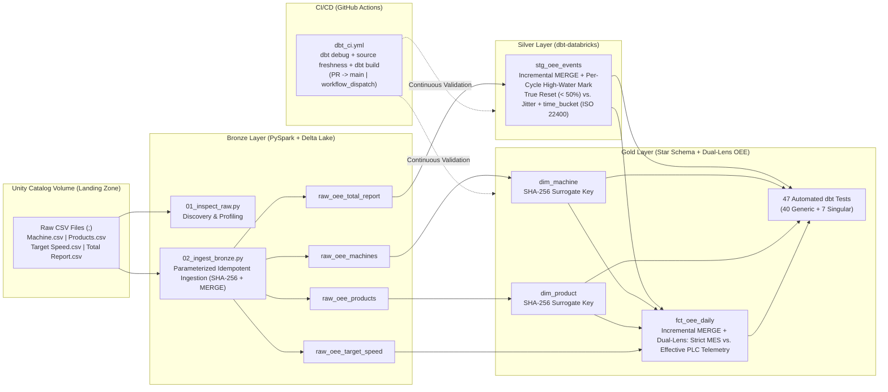

# Industrial OEE Lakehouse

End-to-end **Overall Equipment Effectiveness (OEE)** analytics pipeline for industrial manufacturing, built on **Databricks Free Edition**, **Unity Catalog**, **Delta Lake**, **PySpark**, **dbt-databricks**, and **GitHub Actions**.

Based on the public manufacturing dataset **Enterprise DNA Challenge 18 (*Grandma EDNA's Biscuits*)**, available on Kaggle: [Manufacturing Dataset (Kaggle)](https://www.kaggle.com/datasets/phuongtheson/manufacturing-dataset/data).

This project demonstrates a production-grade **Medallion architecture** — from raw file profiling and parameterized, idempotent Bronze ingestion in Unity Catalog Volumes to an incremental Gold dimensional model (Star Schema) featuring a **Dual-Lens OEE architecture (Strict MES vs. Effective PLC Telemetry)**, industrial odometer reconstruction via per-cycle *High-Water Mark*, **47 automated dbt data quality tests**, operational backfill/FinOps runbooks, and continuous CI/CD.

## Business Context & Manufacturing Process

- **Industry & Operations:** High-throughput continuous/discrete **Food & Beverage / CPG** manufacturing (`43,200` to `51,840 biscuits/hour`), modeled after **Grandma EDNA's Biscuits** (original *Enterprise DNA Power BI Challenge 18 — OEE Manufacturing Report* dataset on [Kaggle](https://www.kaggle.com/datasets/phuongtheson/manufacturing-dataset/data)).
- **Product Portfolio (18 SKUs):** Filled biscuits, wafers, and cookies (such as *Jammy Creams*, *Custard Creams*, *Bourbon Creams*, *Milk Cookies*, and *Chocolate Cookies*), modeled in `dim_product` with full packaging hierarchy (*biscuits per pack*, *biscuits per case*, *cases per pallet*, and *biscuits per pallet*).
- **Production Flow (10 machines across 7 stages):**
  1. **Mixing:** `Biscuit Mixing Machine`
  2. **Forming:** `Biscuit Forming Machine`, `Biscuit Pressing Machine`
  3. **Heating:** `Biscuit Heating Machine`
  4. **Filling:** `Biscuit Filling Machine`, `Biscuit Jam Machine`
  5. **Topping:** `Biscuit Topping Machine`, `Biscuit Sprinkling Machine`
  6. **Packaging:** `Packaging Heat Machine`
  7. **Boxing:** `Biscuit Boxing Machine`
- **Analytical Objective:** Measure plant efficiency via **OEE (*Availability × Performance × Quality*)**, surface losses from changeover/cleaning (`CC`), maintenance (`PM`), and MES status mislabeling, and expose PLC telemetry gaps by machine and SKU.

## Architecture Overview



## Tech Stack

| Layer / Responsibility | Technology |
| --- | --- |
| **Data Source** | [Enterprise DNA Challenge 18 — *Grandma EDNA's Biscuits* (Kaggle)](https://www.kaggle.com/datasets/phuongtheson/manufacturing-dataset/data) |
| **Platform & Governance** | Databricks Free Edition + Unity Catalog (`industrial_lakehouse.{bronze,silver,gold}`) |
| **Storage** | Delta Lake with **Liquid Clustering** |
| **Ingestion (Raw → Bronze)** | PySpark + `DeltaTable` (`MERGE INTO`), parameterized via Databricks widgets (`dry_run`, `run_optimize`) |
| **Transformation (Bronze → Silver → Gold)** | `dbt-databricks` (`dbt-core`), incremental `merge` strategy on Silver and Gold |
| **Data Quality & Observability** | 47 dbt Data Tests (40 generic + 7 singular reconciliation/invariant tests), `on_schema_change='fail'`, and `dbt source freshness` |
| **CI/CD** | GitHub Actions with `requirements.txt` and GitHub Secrets |

## Repository Structure

```text
industrial-oee-lakehouse/
├── .github/
│   └── workflows/
│       └── dbt_ci.yml                                # CI/CD pipeline (dbt debug + source freshness + dbt build)
├── databricks/
│   └── notebooks/
│       ├── 01_inspect_raw.py                         # Raw CSV inspection in Unity Catalog Volume
│       └── 02_ingest_bronze.py                       # Parameterized 1:1 idempotent ingestion (SHA-256 + MERGE)
├── dbt_project/
│   ├── dbt_project.yml                               # dbt project configuration (Silver/Gold Delta)
│   ├── profiles.yml                                  # Databricks profile via env_var()
│   ├── macros/
│   │   └── generate_schema_name.sql                  # Explicit schema routing (silver/gold)
│   ├── models/
│   │   ├── bronze/
│   │   │   └── sources.yml                           # Bronze sources + Source Freshness (ingested_at)
│   │   ├── silver/
│   │   │   ├── stg_oee_events.sql                    # Incremental MERGE, per-cycle High-Water Mark & time_bucket
│   │   │   └── schema.yml                            # 13 Silver generic tests
│   │   └── gold/
│   │       ├── dim_machine.sql                       # Machine dimension (10 machines)
│   │       ├── dim_product.sql                       # Product dimension (18 SKUs)
│   │       ├── fct_oee_daily.sql                     # Incremental Dual-Lens OEE daily fact (date + machine + product)
│   │       └── schema.yml                            # 27 Gold generic tests
│   └── tests/
│       ├── assert_valid_oee_bounds.sql               # Strict & Effective OEE pillars/scores within [0, 1] when non-null
│       ├── assert_effective_telemetry_time_bounds.sql # effective_run_time_telemetry_minutes <= effective_run_time_minutes
│       ├── assert_non_negative_delta_biscuits.sql    # delta_total_biscuits_made >= 0 (Silver & Gold)
│       ├── assert_non_negative_delta_good_biscuits.sql # delta_good_biscuits_made >= 0 (Silver & Gold)
│       ├── assert_gold_time_conservation.sql         # Additive conservation of 5 time buckets (< 0.01 min)
│       ├── assert_quality_null_without_telemetry.sql # quality_rate must be NULL without total-counter telemetry
│       └── assert_silver_gold_reconciliation.sql     # Reconciliation gate (event count, duration, and deltas Silver = Gold)
├── docs/
│   └── OPERATIONS_AND_FINOPS.md                      # Safe partitioned backfill, 5 observability pillars & Delta FinOps runbook
├── requirements.txt                                  # Pinned dbt-databricks dependency for local & CI reproducibility
├── .env.example                                      # Environment variables template (no secrets)
└── .gitignore                                        # Excludes .env, target/, logs/, and .user.yml
```

## Data Quality Audit & Dual-Lens OEE Architecture

A forensic audit across all **8,043 Bronze events** uncovered **3 real structural defects in the source telemetry** (plus missing total-counter telemetry on 8 machines). Rather than masking issues with synthetic imputations, the pipeline enforces **100% volume and duration reconciliation** (`8,043` events and `179,775.96 min`) and exposes two transparent analytical lenses in Gold:

### Physical Proof — Why Dual-Lens OEE?

Cross-referencing `oee_category` labels against net odometer progression (`delta_total_biscuits_made`) in Silver proved a systematic MES status-logging inversion:

| oee_category | events | total_minutes | sum_delta_total | avg_biscuits_per_hour | Physical Interpretation |
| --- | ---: | ---: | ---: | ---: | --- |
| `NO (No Order)` | 3,995 | 137,694.36 | **11,074,662** | **38,839** | **93.9% of actual output** (~80% of 43.2k–51.8k/h target speed) |
| `CC (Changeover Cleaning)` | 4,021 | 33,679.23 | 671,442 | 3,601 | ~11× cadence drop (setup/cleaning ramp) |
| `0` | 12 | 7,950.64 | 44,484 | 79,359 | Unclassified category |
| `Run Time` | 9 | 239.87 | **0** | **0** | **Zero biscuits produced** in literal Run Time records |
| `PM (Maintenance)` | 6 | 211.85 | `NULL` | `NULL` | True maintenance downtime |

Accordingly, `fct_oee_daily.sql` publishes **both lenses side by side**, preserving full backward compatibility:
- **Lens 1 — Strict MES (literal ISO 22400):** relies strictly on the source `oee_category` label (`NO_ORDER` excluded from `planned_production_minutes`, availability computed over `explicit_run_time_minutes`), directly exposing the MES logging defect for governance.
- **Lens 2 — Effective PLC Telemetry:** measures physical production proven by the odometer (`effective_run_time_minutes` over `NO_ORDER`, `availability_rate_effective = effective_run_time_minutes / total_duration_minutes`, and `performance_rate_effective = delta_total_biscuits_effective_run / expected_biscuits_effective`), revealing true shop-floor efficiency (`40.94%` effective OEE and `75.64%` performance on `Biscuit Filling Machine`).

### 3 Structural Engineering Findings Addressed

1. **Cumulative odometer counters in `total` and `good` (solved via per-cycle High-Water Mark)**
   - `totalbiscuitsmade` on `Biscuit Filling Machine` and `Biscuit Sprinkling Machine` is a cumulative counter; summing it directly inflated output to `1.31 billion`. Profiling confirmed `good_biscuits_made` behaves as **CUMULATIVE_ODOMETER** solely on `Biscuit Filling Machine` (`max = 480,646`, `avg = 115,183.3`) and as **PER_EVENT_INCREMENTAL** across the remaining 9 machines (`1..500`, `avg ≈ 250`).
   - In [stg\_oee\_events.sql](https://www.google.com/search?q=dbt_project/models/silver/stg_oee_events.sql), `delta_total_biscuits_made` and `delta_good_biscuits_made` are reconstructed via a **per-cycle High-Water Mark (`running_max`)** with incremental machine anchors, reducing raw `1.31 billion` to **11.79 million** true net biscuits.

2. **Sensor jitter + minute-level timestamp truncation (`HH:mm:00`)**
   - Minute-truncated timestamps create sub-minute ties compounded by minor sensor dips (`-32` to `-171`, `< 0.15%`), which naively triggered **1,486 false resets**.
   - Deterministic window ordering (`start_timestamp, end_timestamp, raw_total_biscuits_made, good_biscuits_made, row_hash`) isolates **true resets (`< 50%`, only 38 events: 23 Filling + 15 Sprinkling)** and filters **1,371 jitter events** (`is_counter_jitter = TRUE`, `delta = 0`).

3. **Missing total-counter telemetry on 8 of 10 machines & inverted status labels (`NO`/`CC`)**
   - Across 8 machines (`1,937` events), `raw_total_biscuits_made = 0` in 100% of rows. Zero artificial imputation is performed: `performance_rate`, `performance_rate_effective`, `quality_rate`, `oee_score`, and `oee_score_effective` return **`NULL`** wherever reliable telemetry is absent, enforced in CI by 7 singular tests.

### Additional Engineering & FinOps Standards
- **Parameterized 1:1 Idempotent Bronze Ingestion (`02_ingest_bronze.py`):** `;` delimiter, `inferSchema=false`, SHA-256 `row_hash` deduplicating 1 exact duplicate in `Total Report.csv` (`8,043` unique rows), `DeltaTable.merge()`, widget parameters (`catalog`, `schema`, `volume_path`, `dry_run`, `run_optimize`), and structured error handling.
- **Incremental Gold & Safe Backfills:** `fct_oee_daily.sql` runs as `materialized='incremental'` (`merge`, `on_schema_change='fail'`) with configurable lookback (`oee_lookback_days`, default `3`) and explicit date-slice backfill variables (`backfill_start_date`, `backfill_end_date`). See [docs/OPERATIONS\_AND\_FINOPS.md](https://www.google.com/search?q=docs/OPERATIONS_AND_FINOPS.md) for the full backfill protocol, 5 observability pillars, and Delta `OPTIMIZE`/`VACUUM` commands.
- **Data Cleansing & Layout:** `TRIM()` on join keys (`0` orphans), `TRY_TO_TIMESTAMP`, European decimal `,` → `.` normalization, typo fix `bsicuits_per_pallet` → `biscuits_per_pallet` in `dim_product` (preserving `cases_per_pallet`), and **Delta Lake Liquid Clustering** across all layers.

## Validated Results (Gold Layer)

### Silver vs. Gold Reconciliation

| Metric | Silver (`stg_oee_events`) | Gold (`fct_oee_daily`) | Status |
| --- | ---: | ---: | :---: |
| Total events | **8,043** | **8,043** *(193 aggregated rows)* | OK |
| Total duration (`minutes`) | **179,775.96** | **179,775.96** | OK |
| `SUM(delta_total_biscuits_made)` | **11,790,588** | **11,790,588** | OK |
| `SUM(delta_good_biscuits_made)` | **10,689,705** | **10,689,705** | OK |
| True resets (`< 50%`) | **38** | **38** | OK |
| Jitter events (`50%..100%`) | **1,371** | **1,371** | OK |

### Weighted Dual-Lens OEE Comparison by Machine (`fct_oee_daily` × `dim_machine`)

Query output via `dbt show` comparing **Strict MES** and **Effective PLC Telemetry** side by side:

| machine_name | strict_avail_pct | strict_oee_pct | effective_avail_pct | effective_perf_pct | weighted_qual_pct | effective_oee_pct |
| --- | ---: | ---: | ---: | ---: | ---: | ---: |
| Biscuit Filling Machine | 1.24 | 1.24 | **54.13** | **75.64** | **100.00** | **40.94** |
| Biscuit Sprinkling Machine | 0.00 | `NULL` | **44.86** | **100.00** | **23.45** | **10.52** |
| Biscuit Topping Machine | 0.00 | `NULL` | 99.31 | `NULL` | `NULL` | `NULL` |
| Packaging Heat Machine | 0.00 | `NULL` | 97.29 | `NULL` | `NULL` | `NULL` |
| Biscuit Jam Machine | 0.00 | `NULL` | 93.72 | `NULL` | `NULL` | `NULL` |
| Biscuit Mixing Machine | 0.00 | `NULL` | 90.38 | `NULL` | `NULL` | `NULL` |
| Biscuit Boxing Machine | 0.00 | `NULL` | 88.81 | `NULL` | `NULL` | `NULL` |
| Biscuit Forming Machine | 0.00 | `NULL` | 80.18 | `NULL` | `NULL` | `NULL` |
| Biscuit Heating Machine | 0.00 | `NULL` | 64.79 | `NULL` | `NULL` | `NULL` |
| Biscuit Pressing Machine | 0.00 | `NULL` | 64.47 | `NULL` | `NULL` | `NULL` |

### Data Governance & Monitoring for the 8 Machines with `NULL` OEE

By explicit governance policy, **8 of the 10 machines report `oee_score` and `oee_score_effective` as `NULL`** in Gold (rather than artificial `0%` or `100%` values):

- **Missing total production telemetry:** in **100% of the 1,937 events** for these 8 machines, `raw_total_biscuits_made = 0` and no scrap column exists in `Total Report.csv`.
- **Quality (`NULL`):** without a reliable total-output denominator, computing Quality would require imputing `total = good` (forcing an artificial `100%`). Gold preserves `NULL`, guarded in CI by `assert_quality_null_without_telemetry.sql`.
- **Performance (`NULL`):** on these machines, `good_biscuits_made` logs only `1` to `500` units per event (`PER_EVENT_INCREMENTAL`), incompatible with the nominal target speed (`~48,960 biscuits/h`); using it as a proxy caused severe distortions (e.g., `0.07%` on `Biscuit Heating Machine`).
- **Operational & BI Guidance:** monitor these 8 machines via **Effective Availability** (`64.47%` to `99.31%`), **Changeover (`CC`) losses**, and a **telemetry coverage alert (`has_total_counter_telemetry = FALSE`)** for PLC/automation teams.

## Running Locally

### Prerequisites
- Python 3.9+ (3.11 recommended)
- Databricks Workspace with Unity Catalog enabled, active SQL Warehouse, and `industrial_lakehouse` catalog (`bronze`, `silver`, `gold`)
- CSV files from [Manufacturing Dataset (Kaggle)](https://www.kaggle.com/datasets/phuongtheson/manufacturing-dataset/data) uploaded to `/Volumes/industrial_lakehouse/bronze/landing_zone/oee/`

### 1. Databricks Ingestion (Raw → Bronze)
Run the notebooks in Databricks Workspace (attached to `industrial_lakehouse`):
1. `databricks/notebooks/01_inspect_raw.py` — validates CSV files, sizes, raw schema, and samples.
2. `databricks/notebooks/02_ingest_bronze.py` — idempotently creates/merges the 4 Bronze Delta tables (supports `dry_run` and `run_optimize` widget parameters).

### 2. Local Environment Setup
Clone the repository and install pinned dependencies:

```powershell
git clone https://github.com/Raniere-Pereira/industrial-oee-lakehouse.git
cd industrial-oee-lakehouse
pip install -r requirements.txt
```

Copy `.env.example` to `.env` at the repository root and fill in your Databricks SQL Warehouse credentials (`.env` is gitignored and must never be committed):

```dotenv
DATABRICKS_HOST=your-workspace.cloud.databricks.com
DATABRICKS_HTTP_PATH=/sql/1.0/warehouses/your-warehouse-id
DATABRICKS_TOKEN=dapi...
```

### 3. Running dbt (PowerShell)
Load `.env` into the current session and run `dbt debug`, `dbt source freshness`, and `dbt build`:

```powershell
Get-Content .env | ForEach-Object {
    if ($_ -match '^\s*([^#][^=]+?)\s*=\s*(.*)\s*$') {
        [Environment]::SetEnvironmentVariable($matches[1], $matches[2], 'Process')
    }
}

cd dbt_project
dbt debug --profiles-dir .
dbt source freshness --profiles-dir .
dbt build --profiles-dir .
```

To run a full Silver + Gold rebuild or a safe single-day backfill slice on Gold (see [docs/OPERATIONS\_AND\_FINOPS.md](https://www.google.com/search?q=docs/OPERATIONS_AND_FINOPS.md)):

```powershell
# Full rebuild
dbt build --profiles-dir . --select stg_oee_events+ --full-refresh

# Safe single-day backfill slice on Gold
dbt run --profiles-dir . --select fct_oee_daily --vars '{"backfill_start_date": "2024-05-01", "backfill_end_date": "2024-05-01"}'
```

To inspect weighted **Dual-Lens OEE** via CLI:

```powershell
dbt show --profiles-dir . --limit 20 --inline "
WITH base AS (
  SELECT
    m.machine_name,
    SUM(f.total_duration_minutes) AS tot_dur,
    SUM(f.planned_production_minutes) AS planned_min,
    SUM(f.explicit_run_time_minutes) AS strict_run_min,
    SUM(f.expected_biscuits) AS strict_exp,
    SUM(f.effective_run_time_minutes) AS eff_run_min,
    SUM(f.delta_total_biscuits_effective_run) AS eff_delta_tot,
    SUM(f.expected_biscuits_effective) AS eff_exp,
    SUM(f.delta_total_biscuits_made) AS delta_tot,
    SUM(f.delta_good_biscuits_made) AS delta_good
  FROM industrial_lakehouse.gold.fct_oee_daily f
  JOIN industrial_lakehouse.gold.dim_machine m
    ON f.machine_sk = m.machine_sk
  GROUP BY 1
),
metrics AS (
  SELECT
    *,
    CASE WHEN planned_min > 0 THEN strict_run_min / planned_min ELSE NULL END AS strict_avail,
    CASE WHEN strict_exp > 0 AND delta_tot IS NOT NULL THEN LEAST(1.0, CAST(delta_tot AS DOUBLE) / strict_exp) ELSE NULL END AS strict_perf,
    CASE WHEN tot_dur > 0 THEN eff_run_min / tot_dur ELSE NULL END AS eff_avail,
    CASE WHEN eff_exp > 0 AND eff_delta_tot IS NOT NULL THEN LEAST(1.0, CAST(eff_delta_tot AS DOUBLE) / eff_exp) ELSE NULL END AS eff_perf,
    CASE WHEN delta_tot IS NOT NULL AND delta_tot > 0 AND delta_good IS NOT NULL THEN LEAST(1.0, CAST(delta_good AS DOUBLE) / CAST(delta_tot AS DOUBLE)) ELSE NULL END AS qual
  FROM base
)
SELECT
  machine_name,
  ROUND(strict_avail * 100, 2) AS strict_avail_pct,
  CASE WHEN strict_avail IS NOT NULL AND strict_perf IS NOT NULL AND qual IS NOT NULL THEN ROUND((strict_avail * strict_perf * qual) * 100, 2) ELSE NULL END AS strict_oee_pct,
  ROUND(eff_avail * 100, 2) AS effective_avail_pct,
  ROUND(eff_perf * 100, 2) AS effective_perf_pct,
  ROUND(qual * 100, 2) AS weighted_qual_pct,
  CASE WHEN eff_avail IS NOT NULL AND eff_perf IS NOT NULL AND qual IS NOT NULL THEN ROUND((eff_avail * eff_perf * qual) * 100, 2) ELSE NULL END AS effective_oee_pct
FROM metrics
ORDER BY effective_oee_pct DESC NULLS LAST, effective_avail_pct DESC
"
```

## CI/CD Execution (GitHub Actions)

The workflow [.github/workflows/dbt\_ci.yml](https://www.google.com/search?q=.github/workflows/dbt_ci.yml) automates full validation (`dbt debug` + `dbt source freshness` + `dbt build`) on:
- **Pull Requests** targeting `main`;
- **Manual triggers** (`workflow_dispatch`) from the GitHub **Actions** tab or GitHub CLI.

### Configuring GitHub Secrets
Under **Settings → Secrets and variables → Actions → New repository secret**, configure:
- `DATABRICKS_HOST`
- `DATABRICKS_HTTP_PATH`
- `DATABRICKS_TOKEN`

### Manual Trigger via GitHub CLI (Optional)
```powershell
gh workflow run dbt_ci.yml
gh run list --limit 3
```
