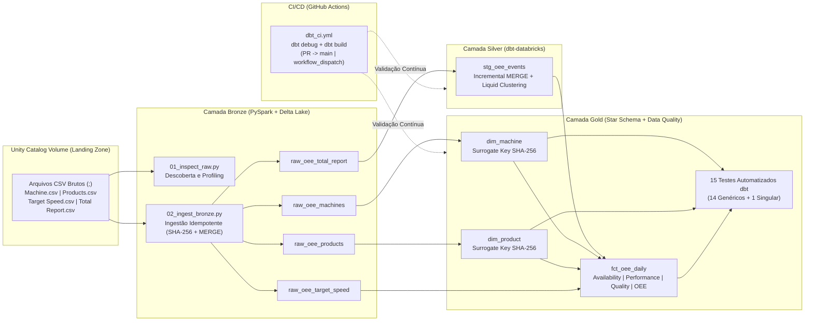

# Industrial OEE Lakehouse

Pipeline analítico end-to-end de **Overall Equipment Effectiveness (OEE)** para manufatura industrial, construído sobre **Databricks Free Edition**, **Unity Catalog**, **Delta Lake**, **PySpark**, **dbt-databricks** e **GitHub Actions**.

O projeto demonstra uma arquitetura **Medallion** completa em produção — da inspeção e ingestão idempotente de arquivos brutos em Unity Catalog Volumes até a modelagem dimensional (Star Schema), testes automatizados de qualidade de dados e CI/CD contínuo.

---

## Visão Geral da Arquitetura



---

## Stack Tecnológica

| Camada / Responsabilidade | Tecnologia |
| --- | --- |
| **Plataforma & Governança** | Databricks Free Edition + Unity Catalog (`industrial_lakehouse.{bronze,silver,gold}`) |
| **Armazenamento** | Delta Lake com **Liquid Clustering** |
| **Ingestão (Raw → Bronze)** | PySpark + `DeltaTable` (`MERGE INTO`) |
| **Transformação (Bronze → Silver → Gold)** | `dbt-databricks` (`dbt-core 1.10`) |
| **Qualidade de Dados** | dbt Data Tests (genéricos + teste singular) e Source Freshness |
| **CI/CD** | GitHub Actions com GitHub Secrets |

---

## Estrutura do Repositório

```text
industrial-oee-lakehouse/
├── .github/
│   └── workflows/
│       └── dbt_ci.yml                      # Pipeline CI/CD (dbt debug + dbt build)
├── databricks/
│   └── notebooks/
│       ├── 01_inspect_raw.py               # Inspeção dos CSVs no Unity Catalog Volume
│       └── 02_ingest_bronze.py             # Ingestão 1:1 idempotente (SHA-256 + MERGE)
├── dbt_project/
│   ├── dbt_project.yml                     # Configuração do projeto dbt (Silver/Gold Delta)
│   ├── profiles.yml                        # Profile Databricks via env_var()
│   ├── macros/
│   │   └── generate_schema_name.sql        # Controle explícito de schemas (silver/gold)
│   ├── models/
│   │   ├── bronze/
│   │   │   └── sources.yml                 # Fontes Bronze + Source Freshness (ingested_at)
│   │   ├── silver/
│   │   │   └── stg_oee_events.sql          # Modelo incremental MERGE + limpeza e tipagem
│   │   └── gold/
│   │       ├── dim_machine.sql             # Dimensão de máquinas (10 máquinas)
│   │       ├── dim_product.sql             # Dimensão de produtos (18 produtos)
│   │       ├── fct_oee_daily.sql           # Fato diária de OEE (grão data + máquina + produto)
│   │       └── schema.yml                  # 14 testes genéricos (not_null, unique, relationships)
│   └── tests/
│       └── assert_valid_oee_bounds.sql     # Teste singular de invariantes de negócio OEE
├── .env.example                            # Template de variáveis de ambiente (sem segredos)
└── .gitignore                              # Proteção de .env, target/, logs/ e .user.yml
```

---

## Decisões Técnicas e Engenharia de Dados

1. **Ingestão Bronze 1:1 Idempotente com SHA-256 (`02_ingest_bronze.py`)**
   - Os arquivos brutos no Volume (`/Volumes/industrial_lakehouse/bronze/landing_zone/oee/`) utilizam delimitador `;` (`.option("sep", ";")`) e são lidos com `inferSchema=false` para preservar fidelidade do dado bruto (*schema-on-read*).
   - Os nomes das colunas são sanitizados para compatibilidade com Delta Lake, mantendo metadados técnicos (`_source_file`, `ingestion_date`, `ingested_at`).
   - Um hash determinístico `row_hash` (`SHA-256` sobre todas as colunas de negócio) garante **deduplicação exata** — eliminando 1 registro duplicado encontrado em `Total Report.csv` (persistindo 8.043 eventos únicos) — e **idempotência** em reexecuções via `DeltaTable.merge(...).whenNotMatchedInsertAll()`.

2. **Limpeza, Tipagem Resiliente e Tratamento de Anomalias na Silver (`stg_oee_events.sql`)**
   - **Normalização de chaves (`TRIM`)**: os nomes de máquinas nos CSVs brutos contêm espaços à direita (ex.: `"Biscuit Filling Machine "`). A aplicação de `TRIM()` em `machine` e `product` garantiu **100% de integridade referencial** entre fatos e dimensões (0 registros órfãos).
   - **Timestamps e decimais europeus**: parsing resiliente com `COALESCE(TRY_TO_TIMESTAMP(..., 'd/M/yy HH:mm'), TRY_TO_TIMESTAMP(..., 'M/d/yy HH:mm'))` e conversão numérica com `TRY_CAST(REPLACE(TRIM(duration), ',', '.') AS DOUBLE)` para suportar vírgula como separador decimal (ex.: `0,816683352`).
   - **Auditoria de anomalias de contadores PLC**: eventos onde o contador reportou `goodmadebiscuits > totalbiscuitsmade` (ex.: `total = 0`, `good = 488`) são padronizados com `total_biscuits_made = GREATEST(raw_total, good)`, preservando `raw_total_biscuits_made` e a flag booleana `is_counter_anomaly` para observabilidade.
   - **Carga incremental**: materialização `incremental` com estratégia `merge` sobre `unique_key='event_id'` (`row_hash`) e deduplicação defensiva via `ROW_NUMBER()`.

3. **Modelagem Dimensional Gold e Correção de Schema (`dim_machine`, `dim_product`, `fct_oee_daily`)**
   - **Surrogate Keys determinísticas**: `machine_sk` e `product_sk` geradas via `SHA2(..., 256)`.
   - **Correção de typo em `dim_product`**: a coluna `bsicuits_per_pallet` da origem foi corrigida para `biscuits_per_pallet` (unidades por palete, ex.: `3360`), enquanto a coluna originalmente rotulada de forma ambígua na origem (`140`, `100`, `360`) foi renomeada semanticamente para `cases_per_pallet`.
   - **Cálculo de OEE em `fct_oee_daily`**: consolidado no grão `(event_date, machine_sk, product_sk)` cruzando com `raw_oee_target_speed` para calcular:
     - `availability_rate` (tempo produtivo sobre duração total, descontando `NO (No Order)` e `PM (Maintenance)`)
     - `performance_rate` (produção real frente à capacidade teórica por `target_biscuits_per_hour`)
     - `quality_rate` (`good_biscuits_made / total_biscuits_made`)
     - `oee_score = availability_rate * performance_rate * quality_rate` (limitado ao intervalo `[0, 1]`).

4. **Otimização com Delta Lake Liquid Clustering**
   - Substituição de particionamento físico estático por **Liquid Clustering** em todas as camadas críticas para evitar *small files* e maximizar *data skipping*:
     - Bronze: `clusterBy("ingestion_date")`
     - Silver (`stg_oee_events`): `liquid_clustered_by=['event_date', 'machine_name']`
     - Gold (`fct_oee_daily`): `liquid_clustered_by=['event_date', 'machine_sk']`

5. **15 Testes Automatizados de Qualidade de Dados (`dbt build`)**
   - **14 testes genéricos** (`models/gold/schema.yml`): `not_null` e `unique` em `machine_sk`, `machine_name`, `product_sk`, `product_name`; `not_null` em `event_date`, `machine_sk`, `product_sk` e `oee_score`; `relationships` garantindo integridade referencial da fato com ambas as dimensões.
   - **1 teste singular** (`tests/assert_valid_oee_bounds.sql`): valida as invariantes de negócio `good_biscuits_made <= total_biscuits_made` e `oee_score BETWEEN 0 AND 1` em 100% das linhas da `fct_oee_daily`.
   - Resultado validado no Databricks: **`PASS=19 WARN=0 ERROR=0`** (4 modelos + 15 testes).

---

## Amostra de Resultados (Camada Gold)

Resultado obtido via `dbt show` agregando `industrial_lakehouse.gold.fct_oee_daily` × `industrial_lakehouse.gold.dim_machine`:

| machine_name | machine_type | avg_avail_pct | avg_perf_pct | avg_qual_pct | avg_oee_pct |
| --- | --- | ---: | ---: | ---: | ---: |
| Biscuit Filling Machine | Filling | 43.55 | 83.21 | 60.67 | 16.48 |
| Biscuit Topping Machine | Topping | 29.19 | 53.78 | 100.00 | 16.00 |
| Biscuit Jam Machine | Filling | 28.79 | 31.22 | 100.00 | 10.38 |
| Biscuit Forming Machine | Forming | 34.67 | 20.16 | 100.00 | 7.21 |
| Biscuit Pressing Machine | Forming | 39.93 | 23.16 | 100.00 | 5.42 |
| Biscuit Mixing Machine | Mixing | 16.63 | 30.53 | 100.00 | 5.31 |
| Biscuit Boxing Machine | Boxing | 33.57 | 22.12 | 100.00 | 3.73 |
| Biscuit Sprinkling Machine | Topping | 55.90 | 93.83 | 11.76 | 3.60 |
| Packaging Heat Machine | Packaging | 5.08 | 52.16 | 100.00 | 1.04 |
| Biscuit Heating Machine | Heating | 50.91 | 0.47 | 100.00 | 0.23 |

---

## Como Executar Localmente

### Pré-requisitos
- Python 3.9+ (recomendado 3.11)
- Workspace Databricks com Unity Catalog habilitado, SQL Warehouse ativo e catálogo `industrial_lakehouse` (`bronze`, `silver`, `gold`)
- Arquivos CSV carregados no Volume `/Volumes/industrial_lakehouse/bronze/landing_zone/oee/`

### 1. Ingestão no Databricks (Raw → Bronze)
Execute os notebooks no Databricks Workspace (conectados ao catálogo `industrial_lakehouse`):
1. `databricks/notebooks/01_inspect_raw.py` — valida os arquivos `.csv`, tamanho, schema bruto e amostra.
2. `databricks/notebooks/02_ingest_bronze.py` — cria/atualiza de forma idempotente as 4 tabelas Delta na camada Bronze.

### 2. Configuração do Ambiente Local
Clone o repositório e instale o `dbt-databricks`:

```powershell
git clone https://github.com/Raniere-Pereira/industrial-oee-lakehouse.git
cd industrial-oee-lakehouse
pip install dbt-databricks
```

Copie o arquivo `.env.example` para `.env` na raiz do repositório e preencha suas credenciais do Databricks SQL Warehouse (`.env` está listado no `.gitignore` e nunca deve ser versionado):

```dotenv
DATABRICKS_HOST=seu-workspace.cloud.databricks.com
DATABRICKS_HTTP_PATH=/sql/1.0/warehouses/seu-warehouse-id
DATABRICKS_TOKEN=dapi...
```

### 3. Execução do dbt (PowerShell)
Carregue as variáveis do `.env` na sessão atual e rode `dbt debug` e `dbt build`:

```powershell
Get-Content .env | ForEach-Object {
    if ($_ -match '^\s*([^#][^=]+?)\s*=\s*(.*)\s*$') {
        [Environment]::SetEnvironmentVariable($matches[1], $matches[2], 'Process')
    }
}

cd dbt_project
dbt debug --profiles-dir .
dbt build --profiles-dir .
```

Para consultar rapidamente os indicadores OEE na camada Gold via CLI:

```powershell
dbt show --profiles-dir . --limit 20 --inline "
SELECT
  m.machine_name,
  m.machine_type,
  ROUND(AVG(f.availability_rate) * 100, 2) AS avg_avail_pct,
  ROUND(AVG(f.performance_rate) * 100, 2)  AS avg_perf_pct,
  ROUND(AVG(f.quality_rate) * 100, 2)      AS avg_qual_pct,
  ROUND(AVG(f.oee_score) * 100, 2)         AS avg_oee_pct
FROM industrial_lakehouse.gold.fct_oee_daily f
JOIN industrial_lakehouse.gold.dim_machine m
  ON f.machine_sk = m.machine_sk
GROUP BY 1, 2
ORDER BY avg_oee_pct DESC
"
```

---

## Execução via CI/CD (GitHub Actions)

O workflow [.github/workflows/dbt_ci.yml](.github/workflows/dbt_ci.yml) automatiza a validação completa (`dbt debug` + `dbt build`) em:
- **Pull Requests** direcionados à branch `main`;
- **Disparo manual** (`workflow_dispatch`) pela aba **Actions** no GitHub ou via GitHub CLI.

### Configuração dos Secrets no GitHub
Em **Settings → Secrets and variables → Actions → New repository secret**, configure:
- `DATABRICKS_HOST`
- `DATABRICKS_HTTP_PATH`
- `DATABRICKS_TOKEN`

### Disparo manual via GitHub CLI (opcional)
```powershell
gh workflow run dbt_ci.yml
gh run list --limit 3
```
