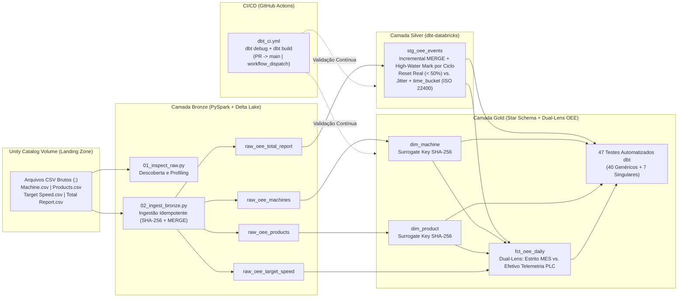

# Industrial OEE Lakehouse

Pipeline analítico end-to-end de **Overall Equipment Effectiveness (OEE)** para manufatura industrial, construído sobre **Databricks Free Edition**, **Unity Catalog**, **Delta Lake**, **PySpark**, **dbt-databricks** e **GitHub Actions**.

Baseado no dataset público de manufatura **Enterprise DNA Challenge 18 (*Grandma EDNA's Biscuits*)**, disponível no Kaggle: [Manufacturing Dataset (Kaggle)](https://www.kaggle.com/datasets/phuongtheson/manufacturing-dataset/data).

O projeto demonstra uma arquitetura **Medallion** completa em produção — da inspeção e ingestão idempotente de arquivos brutos em Unity Catalog Volumes até a modelagem dimensional (Star Schema) com arquitetura **Dual-Lens OEE (Estrito MES vs. Efetivo por Telemetria PLC)**, reconstrução de odômetros industriais via *High-Water Mark* por ciclo, **47 testes automatizados de qualidade de dados** e CI/CD contínuo.

---

## Visão Geral da Arquitetura



---

## Stack Tecnológica

| Camada / Responsabilidade | Tecnologia |
| --- | --- |
| **Fonte de Dados** | [Enterprise DNA Challenge 18 — *Grandma EDNA's Biscuits* (Kaggle)](https://www.kaggle.com/datasets/phuongtheson/manufacturing-dataset/data) |
| **Plataforma & Governança** | Databricks Free Edition + Unity Catalog (`industrial_lakehouse.{bronze,silver,gold}`) |
| **Armazenamento** | Delta Lake com **Liquid Clustering** |
| **Ingestão (Raw → Bronze)** | PySpark + `DeltaTable` (`MERGE INTO`) |
| **Transformação (Bronze → Silver → Gold)** | `dbt-databricks` (`dbt-core 1.10`) |
| **Qualidade de Dados** | 47 dbt Data Tests (40 genéricos + 7 singulares de reconciliação e invariantes) e Source Freshness |
| **CI/CD** | GitHub Actions com GitHub Secrets |

---

## Estrutura do Repositório

```text
industrial-oee-lakehouse/
├── .github/
│   └── workflows/
│       └── dbt_ci.yml                                    # Pipeline CI/CD (dbt debug + dbt build)
├── databricks/
│   └── notebooks/
│       ├── 01_inspect_raw.py                             # Inspeção dos CSVs no Unity Catalog Volume
│       └── 02_ingest_bronze.py                           # Ingestão 1:1 idempotente (SHA-256 + MERGE)
├── dbt_project/
│   ├── dbt_project.yml                                   # Configuração do projeto dbt (Silver/Gold Delta)
│   ├── profiles.yml                                      # Profile Databricks via env_var()
│   ├── macros/
│   │   └── generate_schema_name.sql                      # Controle explícito de schemas (silver/gold)
│   ├── models/
│   │   ├── bronze/
│   │   │   └── sources.yml                               # Fontes Bronze + Source Freshness (ingested_at)
│   │   ├── silver/
│   │   │   ├── stg_oee_events.sql                        # Incremental MERGE, High-Water Mark por ciclo e time_bucket
│   │   │   └── schema.yml                                # 13 testes genéricos da camada Silver
│   │   └── gold/
│   │       ├── dim_machine.sql                           # Dimensão de máquinas (10 máquinas)
│   │       ├── dim_product.sql                           # Dimensão de produtos (18 produtos)
│   │       ├── fct_oee_daily.sql                         # Fato diária Dual-Lens OEE (grão data + máquina + produto)
│   │       └── schema.yml                                # 27 testes genéricos da camada Gold
│   └── tests/
│       ├── assert_valid_oee_bounds.sql                   # Pilares e scores (Estrito + Efetivo) em [0, 1] quando não nulos
│       ├── assert_effective_telemetry_time_bounds.sql    # effective_run_time_telemetry_minutes <= effective_run_time_minutes
│       ├── assert_non_negative_delta_biscuits.sql        # delta_total_biscuits_made >= 0 (Silver e Gold)
│       ├── assert_non_negative_delta_good_biscuits.sql   # delta_good_biscuits_made >= 0 (Silver e Gold)
│       ├── assert_gold_time_conservation.sql             # Conservação aditiva dos 5 buckets de tempo (< 0,01 min)
│       ├── assert_quality_null_without_telemetry.sql     # quality_rate NULL sem telemetria de contador total
│       └── assert_silver_gold_reconciliation.sql         # Gate de reconciliação (eventos, duração e deltas Silver = Gold)
├── .env.example                                          # Template de variáveis de ambiente (sem segredos)
└── .gitignore                                            # Proteção de .env, target/, logs/ e .user.yml
```

---

## Auditoria de Data Quality & Arquitetura Dual-Lens OEE

Uma auditoria forense sobre os **8.043 eventos** da camada Bronze identificou **3 problemas estruturais reais na telemetria de origem** (além da ausência de sensor de contador total em 8 máquinas). Em vez de mascarar os dados com imputações artificiais, a arquitetura foi desenhada com **100% de reconciliação de volume e duração** (`8.043` eventos e `179.775,96 min`) e duas lentes analíticas transparentes na Gold:

### Prova Física — Por que adotamos a Arquitetura Dual-Lens OEE?

Ao cruzar os rótulos de `oee_category` com o avanço líquido real do odômetro (`delta_total_biscuits_made`) na camada Silver, constatou-se uma inversão/falha sistemática de apontamento de status no coletor MES de origem:

| oee_category | events | total_minutes | sum_delta_total | avg_biscuits_per_hour | Interpretação Física |
| --- | ---: | ---: | ---: | ---: | --- |
| `NO (No Order)` | 3.995 | 137.694,36 | **11.074.662** | **38.839** | **93,9% da produção real** (~80% da meta de 43,2k–51,8k/h) |
| `CC (Changeover Cleaning)` | 4.021 | 33.679,23 | 671.442 | 3.601 | Queda de ~11× na cadência (rampa de setup/limpeza) |
| `0` | 12 | 7.950,64 | 44.484 | 79.359 | Categoria não classificada |
| `Run Time` | 9 | 239,87 | **0** | **0** | **Zero biscoitos produzidos** nos registros literais |
| `PM (Maintenance)` | 6 | 211,85 | `NULL` | `NULL` | Parada real de manutenção |

Diante dessa evidência, `fct_oee_daily.sql` expõe **ambas as lentes lado a lado**, preservando 100% de compatibilidade retroativa:
- **Lente 1 — Estrita MES (ISO 22400 literal):** confia apenas no rótulo `oee_category` da origem (`NO_ORDER` excluído de `planned_production_minutes`, disponibilidade calculada sobre `explicit_run_time_minutes`), expondo diretamente a falha de apontamento do MES para governança.
- **Lente 2 — Efetiva por Telemetria PLC:** mede a operação física comprovada pelo odômetro (`effective_run_time_minutes` sobre `NO_ORDER`, `availability_rate_effective = effective_run_time_minutes / total_duration_minutes` e `performance_rate_effective = delta_total_biscuits_effective_run / expected_biscuits_effective`), revelando a eficiência real de chão de fábrica (`40,94%` de OEE efetivo e `75,64%` de performance na `Biscuit Filling Machine`).

### Os 3 Achados Estruturais Tratados na Engenharia

1. **Comportamento de odômetro em `total` e `good` (resolvido via High-Water Mark por ciclo)**
   - `totalbiscuitsmade` na `Biscuit Filling Machine` e na `Biscuit Sprinkling Machine` é um contador acumulado; somá-lo diretamente inflava a produção para `1,31 bilhão`. A auditoria comprovou que `good_biscuits_made` é **`CUMULATIVE_ODOMETER`** exclusivamente na `Biscuit Filling Machine` (`max = 480.646`, `avg = 115.183,3`) e **`PER_EVENT_INCREMENTAL`** nas outras 9 máquinas (`1..500`, `avg ≈ 250`).
   - Em [stg_oee_events.sql](dbt_project/models/silver/stg_oee_events.sql), `delta_total_biscuits_made` e `delta_good_biscuits_made` são reconstruídos via **High-Water Mark (`running_max` dentro de cada ciclo)** com âncoras incrementais por máquina, reduzindo o volume de `1,31 bilhão` bruto para **`11,79 milhões`** líquidos reais.

2. **Jitter de sensor + truncamento de timestamp no minuto (`HH:mm:00`)**
   - Timestamps truncados no minuto geram empates sub-minuto, somados a ruídos de leitura (`-32` a `-171`, `< 0,15%`). Sem tratamento, geravam **1.486 falsos resets**.
   - As janelas desempatam por `start_timestamp, end_timestamp, raw_total_biscuits_made, good_biscuits_made, row_hash`, isolam **resets reais (`< 50%`, apenas 38 eventos: 23 Filling + 15 Sprinkling)** e filtram **1.371 eventos de jitter** (`is_counter_jitter = TRUE`, `delta = 0`).

3. **Ausência de telemetria de contador total em 8 das 10 máquinas e apontamento invertido (`NO`/`CC`)**
   - Em 8 máquinas (`1.937` eventos), `raw_total_biscuits_made = 0` em 100% das linhas. Nenhum valor é imputado artificialmente: `performance_rate`, `performance_rate_effective`, `quality_rate`, `oee_score` e `oee_score_effective` retornam **`NULL`** onde falta telemetria confiável, garantido pelos 7 testes singulares no CI.

### Outras Decisões Técnicas Consolidadas
- **Ingestão Bronze 1:1 Idempotente (`02_ingest_bronze.py`):** delimitador `;`, `inferSchema=false`, `row_hash` (`SHA-256`) removendo 1 duplicata exata do `Total Report.csv` (`8.043` registros únicos) e `DeltaTable.merge()`.
- **Higienização e Otimização:** `TRIM()` em chaves (`0` órfãos nos joins), `TRY_TO_TIMESTAMP`, conversão de decimal europeu `,` → `.`, correção `bsicuits_per_pallet` → `biscuits_per_pallet` em `dim_product` (preservando `cases_per_pallet`) e **Delta Lake Liquid Clustering** em todas as camadas.

---

## Resultados Validados (Camada Gold)

### Reconciliação Silver vs. Gold

| Métrica | Silver (`stg_oee_events`) | Gold (`fct_oee_daily`) | Status |
| --- | ---: | ---: | :---: |
| Total de eventos | **8.043** | **8.043** *(193 linhas agregadas)* | OK |
| Duração total (`minutes`) | **179.775,96** | **179.775,96** | OK |
| `SUM(delta_total_biscuits_made)` | **11.790.588** | **11.790.588** | OK |
| `SUM(delta_good_biscuits_made)` | **10.689.705** | **10.689.705** | OK |
| Resets reais (`< 50%`) | **38** | **38** | OK |
| Eventos de jitter (`50%..100%`) | **1.371** | **1.371** | OK |

### Comparativo Dual-Lens OEE Ponderado por Máquina (`fct_oee_daily` × `dim_machine`)

Resultado obtido via `dbt show` comparando a **Lente Estrita (MES)** e a **Lente Efetiva (Telemetria PLC)** lado a lado:

| machine_name | strict_avail_pct | strict_oee_pct | effective_avail_pct | effective_perf_pct | weighted_qual_pct | effective_oee_pct |
| --- | ---: | ---: | ---: | ---: | ---: | ---: |
| Biscuit Filling Machine | 1,24 | 1,24 | **54,13** | **75,64** | **100,00** | **40,94** |
| Biscuit Sprinkling Machine | 0,00 | `NULL` | **44,86** | **100,00** | **23,45** | **10,52** |
| Biscuit Topping Machine | 0,00 | `NULL` | 99,31 | `NULL` | `NULL` | `NULL` |
| Packaging Heat Machine | 0,00 | `NULL` | 97,29 | `NULL` | `NULL` | `NULL` |
| Biscuit Jam Machine | 0,00 | `NULL` | 93,72 | `NULL` | `NULL` | `NULL` |
| Biscuit Mixing Machine | 0,00 | `NULL` | 90,38 | `NULL` | `NULL` | `NULL` |
| Biscuit Boxing Machine | 0,00 | `NULL` | 88,81 | `NULL` | `NULL` | `NULL` |
| Biscuit Forming Machine | 0,00 | `NULL` | 80,18 | `NULL` | `NULL` | `NULL` |
| Biscuit Heating Machine | 0,00 | `NULL` | 64,79 | `NULL` | `NULL` | `NULL` |
| Biscuit Pressing Machine | 0,00 | `NULL` | 64,47 | `NULL` | `NULL` | `NULL` |

*(As 8 máquinas sem telemetria de contador total reportam `effective_avail_pct` com precisão física e mantêm `effective_perf_pct`, `weighted_qual_pct` e `effective_oee_pct` como `NULL` em vez de imputações artificiais.)*

---

## Como Executar Localmente

### Pré-requisitos
- Python 3.9+ (recomendado 3.11)
- Workspace Databricks com Unity Catalog habilitado, SQL Warehouse ativo e catálogo `industrial_lakehouse` (`bronze`, `silver`, `gold`)
- Arquivos CSV do [Manufacturing Dataset (Kaggle)](https://www.kaggle.com/datasets/phuongtheson/manufacturing-dataset/data) carregados no Volume `/Volumes/industrial_lakehouse/bronze/landing_zone/oee/`

### 1. Ingestão no Databricks (Raw → Bronze)
Execute os notebooks no Databricks Workspace (conectados ao catálogo `industrial_lakehouse`):
1. `databricks/notebooks/01_inspect_raw.py` — valida os arquivos `.csv`, tamanho, schema bruto e amostra.
2. `databricks/notebooks/02_ingest_bronze.py` — cria/atualiza de forma idempotente as 4 tabelas Delta na camada Bronze.

### 2. Configuração do Ambiente Local
Clone o repositório e instale o `dbt-databricks`:

```powershell
git clone https://github.com/Raniere-Pereira/industrial-oee-lakehouse.git
cd industrial-oee-lakehouse
pip install dbt-databricks
```

Copie o arquivo `.env.example` para `.env` na raiz do repositório e preencha suas credenciais do Databricks SQL Warehouse (`.env` está listado no `.gitignore` e nunca deve ser versionado):

```dotenv
DATABRICKS_HOST=seu-workspace.cloud.databricks.com
DATABRICKS_HTTP_PATH=/sql/1.0/warehouses/seu-warehouse-id
DATABRICKS_TOKEN=dapi...
```

### 3. Execução do dbt (PowerShell)
Carregue as variáveis do `.env` na sessão atual e rode `dbt debug` e `dbt build`:

```powershell
Get-Content .env | ForEach-Object {
    if ($_ -match '^\s*([^#][^=]+?)\s*=\s*(.*)\s*$') {
        [Environment]::SetEnvironmentVariable($matches[1], $matches[2], 'Process')
    }
}

cd dbt_project
dbt debug --profiles-dir .
dbt build --profiles-dir .
```

Para executar backfill completo da Silver e Gold (e validar o caminho incremental em seguida):

```powershell
dbt build --profiles-dir . --select stg_oee_events+ --full-refresh
dbt run --profiles-dir . --select stg_oee_events
```

Para consultar o comparativo **Dual-Lens OEE** ponderado via CLI:

```powershell
dbt show --profiles-dir . --limit 20 --inline "
WITH base AS (
    SELECT
        m.machine_name,
        SUM(f.total_duration_minutes) AS tot_dur,
        SUM(f.planned_production_minutes) AS planned_min,
        SUM(f.explicit_run_time_minutes) AS strict_run_min,
        SUM(f.expected_biscuits) AS strict_exp,
        SUM(f.effective_run_time_minutes) AS eff_run_min,
        SUM(f.delta_total_biscuits_effective_run) AS eff_delta_tot,
        SUM(f.expected_biscuits_effective) AS eff_exp,
        SUM(f.delta_total_biscuits_made) AS delta_tot,
        SUM(f.delta_good_biscuits_made) AS delta_good
    FROM industrial_lakehouse.gold.fct_oee_daily f
    JOIN industrial_lakehouse.gold.dim_machine m
      ON f.machine_sk = m.machine_sk
    GROUP BY 1
),
metrics AS (
    SELECT
        *,
        CASE WHEN planned_min > 0 THEN strict_run_min / planned_min ELSE NULL END AS strict_avail,
        CASE WHEN strict_exp > 0 AND delta_tot IS NOT NULL THEN LEAST(1.0, CAST(delta_tot AS DOUBLE) / strict_exp) ELSE NULL END AS strict_perf,
        CASE WHEN tot_dur > 0 THEN eff_run_min / tot_dur ELSE NULL END AS eff_avail,
        CASE WHEN eff_exp > 0 AND eff_delta_tot IS NOT NULL THEN LEAST(1.0, CAST(eff_delta_tot AS DOUBLE) / eff_exp) ELSE NULL END AS eff_perf,
        CASE WHEN delta_tot IS NOT NULL AND delta_tot > 0 AND delta_good IS NOT NULL THEN LEAST(1.0, CAST(delta_good AS DOUBLE) / CAST(delta_tot AS DOUBLE)) ELSE NULL END AS qual
    FROM base
)
SELECT
    machine_name,
    ROUND(strict_avail * 100, 2) AS strict_avail_pct,
    CASE WHEN strict_avail IS NOT NULL AND strict_perf IS NOT NULL AND qual IS NOT NULL THEN ROUND((strict_avail * strict_perf * qual) * 100, 2) ELSE NULL END AS strict_oee_pct,
    ROUND(eff_avail * 100, 2) AS effective_avail_pct,
    ROUND(eff_perf * 100, 2) AS effective_perf_pct,
    ROUND(qual * 100, 2) AS weighted_qual_pct,
    CASE WHEN eff_avail IS NOT NULL AND eff_perf IS NOT NULL AND qual IS NOT NULL THEN ROUND((eff_avail * eff_perf * qual) * 100, 2) ELSE NULL END AS effective_oee_pct
FROM metrics
ORDER BY effective_oee_pct DESC NULLS LAST, effective_avail_pct DESC
"
```

---

## Execução via CI/CD (GitHub Actions)

O workflow [.github/workflows/dbt_ci.yml](.github/workflows/dbt_ci.yml) automatiza a validação completa (`dbt debug` + `dbt build`) em:
- **Pull Requests** direcionados à branch `main`;
- **Disparo manual** (`workflow_dispatch`) pela aba **Actions** no GitHub ou via GitHub CLI.

### Configuração dos Secrets no GitHub
Em **Settings → Secrets and variables → Actions → New repository secret**, configure:
- `DATABRICKS_HOST`
- `DATABRICKS_HTTP_PATH`
- `DATABRICKS_TOKEN`

### Disparo manual via GitHub CLI (opcional)
```powershell
gh workflow run dbt_ci.yml
gh run list --limit 3
```
